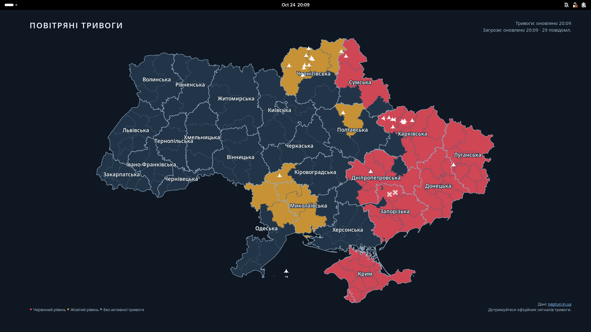

# Air Raid Map for GNOME

This program shows the air-raid alerts across Ukraine as your GNOME desktop
wallpaper. It draws the map from live NEPTUN data with GJS and Cairo, and it
uses no browser. A systemd user timer starts the updater every 30 seconds.
Each run draws a new picture only when the content changes, sets the
wallpaper, and exits. Nothing stays in memory between runs.

**Original idea:** [FullyRealist/LivelyAirRaidAlert](https://github.com/FullyRealist/LivelyAirRaidAlert)
shows a live alert map on Windows through Lively Wallpaper. Credit for the
original wallpaper idea belongs to FullyRealist. This project brings the idea
to GNOME on Linux. It draws a native map from NEPTUN's public alert, threat,
and boundary data.

**KDE Plasma 6:** use [plasma-air-raid-map](https://github.com/p5ych0/plasma-air-raid-map).
This project is the GNOME version of it.



GNOME Shell 50 on Fedora 44, one 1920×1080 monitor, live NEPTUN data
(24 October 2026, 20:09 UTC).

## Requirements

- GNOME 46 or newer, on Linux. We test on Fedora 44 (GNOME 50) and
  Ubuntu 24.04 (GNOME 46). Other distributions with GNOME 46 or newer, for
  example Ubuntu 26.04 LTS and Debian 13, should also work, but we do not
  test them.
- A systemd user session.
- Internet access to `neptun.in.ua` over HTTPS, and the system CA
  certificates (package `ca-certificates`).

The program needs no root access, no browser, no Node.js, and no API key.

The installer checks for the items in this table. A standard GNOME desktop
has all of them. If one is missing, the installer prints the package name
and stops.

| Item | Fedora package | Debian and Ubuntu package |
|---|---|---|
| `gjs` | `gjs` | `gjs` |
| `gsettings` | `glib2` | `libglib2.0-bin` |
| `systemctl` | `systemd` | `systemd` |
| libsoup 3 | `libsoup3` | `gir1.2-soup-3.0` |
| Pango and PangoCairo | `pango` | `gir1.2-pango-1.0` |
| Cairo | `cairo-gobject` | `gir1.2-freedesktop` |
| The settings schema `org.gnome.desktop.background` | `gsettings-desktop-schemas` | `gsettings-desktop-schemas` |

To install these packages and the CA certificates on Fedora:

```sh
sudo dnf install gjs glib2 libsoup3 pango cairo-gobject gsettings-desktop-schemas ca-certificates
```

To install these packages and the CA certificates on Debian and Ubuntu:

```sh
sudo apt install gjs libglib2.0-bin gir1.2-soup-3.0 gir1.2-pango-1.0 gir1.2-freedesktop gsettings-desktop-schemas ca-certificates
```

## Install

Run the installer as your normal user. Do not use `sudo`.

```sh
git clone https://github.com/p5ych0/gnome-air-raid-map.git
cd gnome-air-raid-map
./install.sh
```

The installer prints `gnome-air-raid-map: installed.` The wallpaper shows the
map within a few seconds.

If no graphical session runs (for example, over SSH), the installer only
enables the timer. The map then starts at your next graphical login.

To see the timer and the last runs:

```sh
systemctl --user list-timers gnome-air-raid-map.timer
journalctl --user -u gnome-air-raid-map.service -n 20
```

### Update

```sh
cd gnome-air-raid-map
git pull
./install.sh
```

The installer replaces the program. It keeps the wallpaper settings that it
saved at the first install.

### Uninstall

```sh
./install.sh --uninstall
```

The uninstall stops the timer and puts back your wallpaper settings from
before the first install. Then it deletes all files of the program.

### What the program changes

The program writes only in your home folder, in your user session, and in
your own GNOME settings. It does not change system files, the lock-screen
picture, or the settings of other users.

| Location | Written by | Content |
|---|---|---|
| `~/.local/share/gnome-air-raid-map/` | Installer | The program (`core/`, `updater/`, `LICENSE`) and the failure banner `banner.png` |
| `~/.config/systemd/user/` | Installer | The units `gnome-air-raid-map.service`, `gnome-air-raid-map.timer`, and `gnome-air-raid-map-failed.service` |
| `~/.local/state/gnome-air-raid-map/previous-wallpaper` | Installer | Your wallpaper settings from before the first install |
| `~/.cache/gnome-air-raid-map/` | Updater | The NEPTUN boundary files, with their ETags and the time of the last check |
| `$XDG_RUNTIME_DIR/gnome-air-raid-map/` | Updater | The wallpaper picture and the state file. This folder is in RAM, and the system deletes it at logout. |

These paths are the defaults. If you set `XDG_DATA_HOME`, `XDG_CONFIG_HOME`,
`XDG_STATE_HOME`, or `XDG_CACHE_HOME`, the program uses those folders.

The installer enables the timer for `graphical-session.target`. The updater
sets these keys of `org.gnome.desktop.background`:

- `picture-uri` and `picture-uri-dark`: the picture in
  `$XDG_RUNTIME_DIR/gnome-air-raid-map/`.
- `picture-options`: `spanned`.

When a run fails, the failure unit sets `picture-uri` and `picture-uri-dark`
to the banner. It also sets `picture-options` to `centered` and
`primary-color` to `#0e1722`. The uninstall puts back all four keys.

## What the picture shows

- The oblasts and raions (districts) of Ukraine, with the oblast names in
  Ukrainian.
- The red and yellow alert levels from NEPTUN. The map draws red after
  yellow, so a yellow alert cannot hide a red alert.
- Small white threat icons at the positions that NEPTUN reports. The types
  are drones, FPV drones, reconnaissance aircraft, cruise missiles, ballistic
  missiles, guided bombs (КАБ), MiG-31K aircraft, and unknown threats.
- Each icon is 12 to 16 logical pixels, with no background and no type label.
  A group shows only a small count, such as **×2** or **×3**. Advisory icons
  are blue.
- An icon turns to its direction only when NEPTUN gives a direction without
  its presumed-course flag. The updater does not predict movement between
  runs.
- A report outside the map area does not show. The updater never moves it to
  the edge of the map.
- Reports with a region but no position show in a list at the left, never on
  the map. A long list ends with an overflow count. Advisory reports in the
  list have the label **Спостереження**.
- Top left: the title **ПОВІТРЯНІ ТРИВОГИ**.
- Top right: **Тривоги: оновлено HH:MM** and
  **Загрози: оновлено HH:MM · N повідомл.** HH:MM is the time of the last
  successful update of that feed. N is the number of active threat reports.
- Bottom left: the legend. Bottom right: **Дані: neptun.in.ua** and
  **Дотримуйтеся офіційних сигналів тривоги.** (Follow official air-raid
  alerts.)

### Stale data

The picture never shows old data as current data. It never shows "no alert"
after a failed request.

- Data is stale after a failed request or an invalid response. It is also
  stale 90 seconds after the last valid response.
- An invalid response never replaces the last valid data.
- Stale alerts: the alert colors show at 40 % opacity. The status line shows
  **ДАНІ ЗАСТАРІЛИ**. The center of the map shows
  **Немає актуальних даних тривог**.
- Stale threats: the map shows no threat icons and no region list. The status
  line shows **Загрози: немає актуальних даних**.
- Before the first valid alert data, the status line shows
  **ОЧІКУВАННЯ ДАНИХ**.
- Without the boundary files (for example, NEPTUN is not available at the
  first run), the picture shows **Завантаження мапи…**.
- A failure of the threat feed does not stop the alert updates. A failure of
  the alert feed does not stop the threat updates.
- The picture is in RAM. After a logout or a reboot, GNOME cannot show an old
  map as current data.

### Failure banner

A failed request does not stop a run. The run draws the stale data with the
marks above. A run fails only on an error of its own. For example, a run
fails at the 25-second time limit or at the 300 MB memory limit.

When a run fails, a second unit shows the failure banner. The banner has
three lines:

- **НЕ ОНОВЛЮЄТЬСЯ** (not updating)
- **Дані на шпалерах можуть бути застарілими** (the wallpaper data can be
  out of date)
- **Дотримуйтеся офіційних сигналів тривоги.** (Follow official air-raid
  alerts.)

The banner shows no time. The next good run puts the live map back.

## Multiple monitors

- The updater sets one picture for all monitors, with `picture-options` set
  to `spanned`.
- Each monitor gets its own full map, with all text, in the size and aspect
  ratio of that monitor.
- The picture has enough pixels for the monitor with the highest scale. Text
  and lines are sharp on each monitor.
- Each run reads the monitor layout from GNOME. After you change the
  resolution, rotation, scale, or monitors, the next run draws a new picture.
  This takes 30 seconds or less.
- The text starts 96 logical pixels from the left edge, so the Ubuntu Dock
  does not cover it. On the other edges, the margin is 64 pixels. The top bar
  does not cover the text.

We tested these layouts in GNOME 50 (Fedora 44) and GNOME 46 (Ubuntu 24.04):

| Layout | Monitors | Scales | GNOME 50 | GNOME 46 |
|---|---|---|---|---|
| 1 | 1920×1080 | 1 | Pass | Pass |
| 2 | 3840×2160 | 2 | Pass | Pass |
| 3 | 1080×1920 (portrait) | 1 | Pass | Pass |
| 4 | 1920×1080 and 2560×1080 | 1 and 1 | Pass | Pass |
| 5 | 1920×1080 and 3840×2160 | 1 and 2 | Pass | Pass, also with "Fractional Scaling" on |

"Pass" means that each monitor shows one whole map, centered, not cut, and
not stretched. All 25 test points on each monitor show the correct pixel of
the picture. Monitors with different scales work, so there is no limit for
mixed-scale setups. The details are in
[docs/decisions/2026-10-23-multi-monitor-mode.md](docs/decisions/2026-10-23-multi-monitor-mode.md).

We did not test these setups:

- Fractional scales, such as 125 % or 150 %. The picture can move by one
  pixel.
- Monitors above one another, or monitors with different top edges.

GNOME shows the failure banner (1200×360) at its own size, in the center of
each monitor. On a portrait monitor 1080 pixels wide, GNOME cuts 60 pixels of
plain background at each side of the banner. The text stays fully visible.

## Limits

- **A picture, not a live map.** You cannot zoom, pan, or click the map. The
  text `neptun.in.ua` on the picture is not a link. The picture has no
  animation and no sound.
- **Delay.** The timer starts a run 30 seconds after the start of the last
  run. A change in the NEPTUN data shows on the wallpaper within 30 seconds
  plus the time of one run. A run usually takes less than 1 second. On a slow
  network, the requests can add up to 15 seconds (the time limit of a
  request).
- **Picture changes.** The status time changes each minute, so the picture
  changes at least once a minute. GNOME fades to each new picture in
  1 second.
- **Size cap.** The picture has 16,600,000 pixels or fewer (the area of two 4K
  monitors). For a larger layout, the updater scales the whole picture down,
  and GNOME scales it up again. The aspect ratio does not change. Very large
  setups (5K, 8K, or three or more 4K monitors) lose some sharpness.
- **Trust store.** The updater checks the NEPTUN certificate against the
  system CA file `/etc/ssl/certs/ca-certificates.crt`. On Debian and Ubuntu,
  that is the default trust store. On Fedora, it replaces the p11-kit trust
  store, to use less CPU time. On Fedora, `update-ca-trust` writes that file.
  On Debian and Ubuntu, `update-ca-certificates` writes it. Run that tool
  after you change the system trust. If the file is missing or empty, the
  updater uses the default trust store.
- **Language.** The text on the picture is in Ukrainian only.
- **Memory of GNOME Shell.** GNOME Shell keeps some freed memory after
  picture changes. The amount stops at a ceiling. See "Resource use".
- **Freeze risk.** A rare GJS deadlock can freeze GNOME Shell when another
  program changes a setting at the same moment. See issue
  [#10](https://github.com/p5ych0/gnome-air-raid-map/issues/10).

### Resource use

We measured these values on Fedora 44:

- One run at 1920×1080 uses a median of 0.21 s of CPU time (max 0.31 s in
  1,000 runs) and 71 to 75 MB of peak memory.
- With the real timer against NEPTUN, at 1920×1080, the average was 0.68 %
  of one CPU core (two 35-minute measurements). That build kept a prepared
  copy of the boundary files. The current build does not, so we estimate
  about 2 % more updater CPU time: about 0.70 % of one core.
- At the size cap with two equal 4K monitors, a run uses 0.62 s of CPU time
  or less. With three different monitors at the cap, a run uses up to 0.95 s
  on a quiet machine. When other programs load the machine, a run can use
  about 1.3 s. We measured these values with the prepared copy too. Without
  it, a run uses about 5 ms more.
- GNOME Shell over 24 hours, at 1920×1080 with the default label mode,
  compared with a session without the updater:
  - The updater adds 0.504 % of one CPU core to the Shell service (the
    Shell and its glycin image loaders).
  - The memory of `gnome-shell` rises for about 12 hours and then stops at
    a ceiling. In the last 12 hours, its anonymous memory after one garbage
    collection stayed at about 200 to 240 MB.
  - The cause is the C library (glibc). It keeps the freed memory of old
    pictures inside `gnome-shell`, for later use. A call of `malloc_trim(0)`
    gives this memory back to the system.
  - The live memory of `gnome-shell` does not grow. A test of 4,176
    picture changes ran with `MALLOC_MMAP_THRESHOLD_=131072` set in the
    test Shell. This setting makes glibc give each freed picture back to
    the system at once. It was a test setting, not a recommendation. After
    three garbage collections, the memory of
    `gnome-shell` rose by 7.5 MB in the first 418 changes. In the next
    3,758 changes, it rose by 1 MB.
  - The details are in
    [docs/decisions/2026-10-25-shell-memory.md](docs/decisions/2026-10-25-shell-memory.md).
- The service limits each run to 300 MB of memory and 25 seconds.

## Live GNOME Shell extension: in development

A live GNOME Shell extension is in development in this repository. It will
draw the map directly on the desktop background, inside GNOME Shell. It is
not ready yet. Until it is ready, use the wallpaper updater.

## Development

The program needs no build step. It uses GJS with ES modules, libsoup 3,
Cairo, Pango, and Gio. It has no npm packages, no Python, and no compiled
code.

Run the unit tests with the GJS of your computer:

```sh
tests/run.sh
```

The GNOME tests use a headless GNOME Shell in a disposable Podman container.
They do not change your computer. There are two images: `fedora44` (GNOME 50,
GJS 1.88) and `ubuntu2404` (GNOME 46, GJS 1.80).

```sh
tests/gnome/run.sh fedora44 unit
tests/gnome/run.sh ubuntu2404 unit
tests/gnome/run.sh fedora44 run 1920x1080
```

The general form is `tests/gnome/run.sh <image> <scenario> [monitor ...]`.
The output goes to `tests/gnome/out/<image>-<scenario>/`.

| Scenario | What it does |
|---|---|
| `unit` | Runs `tests/run.sh` with the GJS of the image. |
| `run` | Runs the updater 3 times against NEPTUN, 30 seconds apart, and takes a screenshot after each run. |
| `reload` | Writes 100 pictures with each reload method and checks that GNOME shows each one. |
| `layouts` | Checks the monitor layouts of the table in "Multiple monitors". |
| `install` | Installs the program, shows the failure banner, and uninstalls the program. |

`tests/gnome/run-systemd.sh <image> systemd` tests the real units and
`install.sh` under a real systemd user manager.

### Leak checks

The 1,000-run checks use a local fixture server, not NEPTUN. They need `curl`
and GNU `time` (`/usr/bin/time`). First, download
the NEPTUN files once into `tests/leak/.cache/`. Git ignores this folder.
Do not commit these files.

```sh
tests/leak/fetch-geometry.sh
mkdir -p out
tests/leak/run-many.sh 1000 1920x1080@1 > out/leak-1080.txt
gjs -m tests/leak/summarize.js --peak-limit 122880 out/leak-1080.txt
tests/leak/run-many.sh 1000 3840x2160@1,3840x2160@1 > out/leak-cap.txt
gjs -m tests/leak/summarize.js --peak-limit 204800 out/leak-cap.txt
```

`run-many.sh` checks the files and the processes after the runs.
`summarize.js` checks the exit codes, the peak memory and its trend, and the
CPU time of each run.

The 24-hour soak runs the real timer against NEPTUN in three GNOME sessions.
Two sessions run the updater, and one session is a control without it. The
header of `tests/leak/soak.sh` gives the full command, which keeps the
computer awake. The soak needs `gdb` on the host: each hourly probe calls
`malloc_trim(0)` in `gnome-shell` of each session.

```sh
tests/leak/soak.sh 86400
gjs -m tests/leak/summarize.js --soak --expect 86400 tests/gnome/out/soak-latest
```

### Other tools

- `gjs -m tests/render-fixtures.js <folder>` draws the visual fixtures with
  synthetic data, at four sizes.
- These environment variables change a run for tests:
  - `AIR_RAID_MAP_API_BASE`: another server instead of `https://neptun.in.ua`.
  - `AIR_RAID_MAP_DISPLAY`: a fixed layout, for example `1920x1080@1`.
  - `AIR_RAID_MAP_LABEL_MODE`: `updated` (the default) or `unchanged`.
  - `AIR_RAID_MAP_PICTURE_OPTIONS`: `spanned` (the default) or `zoom`.
- The design is in
  [docs/superpowers/specs/](docs/superpowers/specs/2026-10-23-gnome-air-raid-map-design.md).
  The test results that decided the design are in [docs/decisions/](docs/decisions/).

## Data and terms

- The data comes from [NEPTUN](https://neptun.in.ua/): the alerts, the
  threats, and the oblast and raion boundaries.
- The updater sends only GET requests, and it runs at most once every
  30 seconds. Each run requests `/api/v1/alerts` and `/api/v1/threats`.
- The updater checks the boundary files at most once an hour, with a
  conditional request.
- This repository does not contain NEPTUN's GeoJSON files. The updater
  downloads them and keeps them in `~/.cache/gnome-air-raid-map/`. The
  boundary data belongs to its owners (OpenStreetMap and others).
- Each map shows the attribution **Дані: neptun.in.ua**.

See [NEPTUN's API documentation](https://neptun.in.ua/developers) and
[terms](https://neptun.in.ua/api-terms).

NEPTUN is an information aggregator, not an official alert system. The
provider controls the availability and the accuracy of the data.
**Follow official air-raid alerts.**

## Credits and license

- Original live-wallpaper idea: [FullyRealist/LivelyAirRaidAlert](https://github.com/FullyRealist/LivelyAirRaidAlert).
- KDE Plasma 6 version, whose map, data rules, and threat symbols this
  project ports: [p5ych0/plasma-air-raid-map](https://github.com/p5ych0/plasma-air-raid-map).
- Alert, threat, and map-boundary data: [NEPTUN](https://neptun.in.ua/),
  under its provider terms.
- This project: MIT license. See [LICENSE](LICENSE).

The MIT license of this repository does not relicense provider content or
services.
